# HUEXE Architecture Map

## Overview
HUEXE is a high-fashion motion website and bespoke headless/integrated CMS designed for mother agency talent management and remote production.

## System Components

```mermaid
flowchart TD
    User["Public Visitors / Clients / Talent"] --> NextEdge["Next.js 16 (Cloudflare / Edge / Node)"]
    Admin["Studio Admin / Scouts"] --> NextAdmin["/admin CMS Interface"]
    
    subgraph Frontend["Frontend Layer"]
        NextEdge --> Hero["Hero (WebGL Canvas + GSAP)"]
        NextEdge --> Roster["Talent Roster (GSAP Flip Filter)"]
        NextEdge --> Narrative["Narrative (Horizontal Scroll)"]
        NextEdge --> Services["Services & Portfolio"]
        NextEdge --> Apply["Apply Drawer (Digitals Upload)"]
        NextEdge --> TalentDetail["/talent/[slug] & Comp Card"]
    end
    
    subgraph CMS["CMS & Operations Layer"]
        NextAdmin --> DashOverview["Dashboard Overview & Metrics"]
        NextAdmin --> DashRoster["Roster CRUD (/admin/models)"]
        NextAdmin --> DashPortfolio["Portfolio CRUD (/admin/campaigns)"]
        NextAdmin --> DashPipeline["Scouting Review (/admin/applications)"]
        NextAdmin --> DashInquiries["B2B Inquiries (/admin/inquiries)"]
        NextAdmin --> DashTeam["Team & RBAC (/admin/team)"]
    end
    
    subgraph DataLayer["Persistence & Storage"]
        NextEdge & NextAdmin --> Drizzle["Drizzle ORM Layer"]
        Drizzle --> PostgreSQL["PostgreSQL (Neon / Supabase / Hyperdrive)"]
        NextEdge & NextAdmin --> MediaAPI["/api/media/[id] & /api/upload"]
        MediaAPI --> MediaAssets["Media Assets Bucket / Cloudflare R2 / DB"]
    end
```

## Security Model
- **Authentication**: Cookie session (`huexe_session`) using cryptographically secure tokens.
- **Password Security**: Scrypt hashing with individual 16-byte random salts and constant-time comparison (`timingSafeEqual`).
- **RBAC**: Roles: `owner` (full access + team management), `editor` (roster, portfolio, pipeline), `scout` (pipeline review).
- **Public Endpoints**: Server actions with payload validation and safe error boundaries.

